# pokebuddy 설명서

이 문서는 설치 파일로 pokebuddy 를 쓰는 사람을 위한 설명서예요. 설치, 게임 방법, 팁, 설정, 문제 해결을 적어요. 같은 내용을 [웹 가이드](https://milklotion.github.io/pokebuddy/guide/)로도 볼 수 있어요.

- 저장소에서 실행하는 방법, CLI 명령, 빌드와 릴리스는 [개발과 배포](contributing/development.md)에 있어요.
- 포켓몬의 움직임과 CLI 상태 연동의 원리는 [동반자 동작](specs/companion.md)에 있어요.
- 게임 규칙은 [게임 규칙](specs/game.md)을, 가격과 확률은 [밸런스 수치](specs/balance.md)를 따라요.
- 화면 명칭은 [용어사전](terms.md)을 따라요.

## 설치

[최신 릴리스](https://github.com/MilkLotion/pokebuddy/releases/latest)에서 설치 파일을 받아요. Node.js 는 필요 없어요.
모든 설치본은 같은 [저장 폴더](#저장-폴더)를 써요. 앱을 지웠다 다시 깔아도 파티와 포인트가 남아요.

### Windows

`pokebuddy-Setup-<버전>.exe` 를 실행해요.

- 코드 서명이 없어요. 처음 실행하면 "Windows의 PC 보호" 창이 떠요. `추가 정보` 를 누른 뒤 `실행` 을 눌러요.
- 묻지 않고 바로 설치해요. 설치 위치는 `%LOCALAPPDATA%\Programs\pokebuddy` 예요. 관리자 권한이 필요 없어요.
- 설치가 끝나면 앱이 떠요. 처음이면 첫 포켓몬 선택 창이 떠요.
- 시작 메뉴와 바탕화면에 바로가기를 만들어요.
- 앱이 떠 있을 때 바로가기를 다시 누르면 설정창이 열려요.

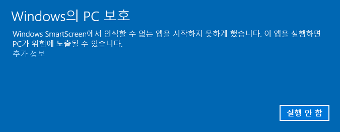

<!-- 이미지 [install-windows-run]: `추가 정보` 를 누른 뒤 `실행` 단추가 보이는 SmartScreen 창 — images/README.md -->

### Mac

Apple Silicon 은 `PokeBuddy-<버전>-arm64.dmg`, Intel 은 `PokeBuddy-<버전>-x64.dmg` 를 열어요.

- `PokeBuddy` 를 `Applications` 로 끌어 넣어요.
- Apple 공증이 없어요. 처음 열면 "Apple 이 확인할 수 없음" 경고가 떠요. 시스템 설정 → 개인정보 보호 및 보안 → 아래의 `그래도 열기` 를 눌러요.
- 경고 대신 "손상되었기 때문에 열 수 없습니다"가 뜨면 터미널에서 `xattr -dr com.apple.quarantine /Applications/PokeBuddy.app` 을 실행한 뒤 다시 열어요.
- 계정·교환 로그인 정보는 키체인 키 `PokeBuddy Safe Storage` 로 암호화해요. 0.9.0 이하에서 올라오면 이 키의 허용 창이 한 번 떠요. 로그인 암호를 넣고 `항상 허용` 을 눌러요. 그 뒤 업데이트에서는 다시 묻지 않아요.
- 앱은 Dock 에 남지 않아요. 메뉴 막대 아이콘으로 있어요.
- 앱이 떠 있을 때 앱을 다시 열면 설정창이 열려요.

<!-- 이미지 [install-mac-open-anyway]: 시스템 설정 → 개인정보 보호 및 보안의 `그래도 열기` 단추 — images/README.md -->
<!-- 이미지 [install-mac-keychain]: `PokeBuddy Safe Storage` 키체인 허용 창 — images/README.md -->

### 업데이트

- 앱이 켜진 채로 새 버전을 받아요. 켠 뒤 5초, 그 뒤 6시간마다 확인해요. 설정창을 열 때도 확인해요. 받는 동안에도 게임은 그대로 해요.
- 다 받으면 `새 버전이 준비됐어요` 창이 한 번 떠요. `지금 다시 시작` 을 누르면 바로 바뀌어요. `나중에` 를 누르면 앱을 끌 때 바뀌어요. 설정 모달 아래에도 "새 버전 준비됨"과 `다시 시작` 이 떠요.
- 서버가 지금 버전을 받지 않으면(계정 탭 "업데이트해야 계정에 저장돼요") 바로 새 버전을 받아요. 다 받으면 `새 버전으로 바꿔야 해요` 창이 떠요. `지금 다시 시작` 을 누르면 바뀌고 계정 저장이 이어져요. `나중에` 를 눌러도 게임은 계속되고, 끌 때 적용해요.
- Mac 앱이 앱 폴더에 쓸 수 없으면(dmg 안에서 바로 실행 등) 새 버전을 받지 못해요. 이때는 `새 버전이 나왔어요` 창과 설정 모달 아래에 `받기` 가 떠요. `받기` 는 새 dmg 를 받을 곳을 열어요.
- 설정 모달 아래의 `패치노트` 에서 버전마다 바뀐 것을 봐요. 업데이트한 뒤 설정창을 처음 열면 그 버전의 패치노트가 한 번 떠요.
- Windows 0.6.0 이하는 0.7.0 설치 파일을 한 번 손으로 실행해야 해요. Mac 0.8.0 이하는 0.9.0 dmg 로 한 번 덮어 설치해야 해요.

### 끄기와 제거

- 끄기는 트레이(Mac 은 메뉴 막대) 아이콘 메뉴의 `종료` 로 해요.
- 설정의 `로그인 시 시작` 이 켜져 있으면 컴퓨터에 로그인할 때 함께 떠요. 기본값은 켜짐이에요.
- Windows 는 Windows 설정의 앱 목록에서 제거해요. Mac 은 `Applications` 의 `PokeBuddy` 를 휴지통으로 옮겨요.
- 제거해도 [저장 폴더](#저장-폴더)는 남아요. 완전히 지우려면 이 폴더를 직접 지워요.

### 저장 폴더

저장·설정·받은 그림은 OS 의 앱 데이터 폴더에 있어요.

| OS | 저장 폴더 |
|---|---|
| Windows | `C:\Users\<사용자>\AppData\Roaming\pokebuddy` |
| Mac | `~/Library/Application Support/pokebuddy` |

- 0.19.5 까지는 `~/.claude/pokebuddy` 에 있었어요. 새 버전을 처음 켜면 이 폴더를 통째로 저장 폴더로 옮겨요. 따로 할 일은 없어요.
- 옛 버전 앱이 떠 있거나 파일이 잠겨 옮기지 못하면, 그 실행은 옛 폴더를 그대로 써요. 다음 실행에 다시 옮겨요.
- 옮긴 뒤 0.19.5 이하를 다시 설치하면, 그 버전은 옮긴 저장을 찾지 못해 새 게임으로 시작해요. 새 버전으로 다시 올리면 옮긴 저장을 써요.

## 처음 시작하기

1. 첫 포켓몬 선택 창에서 함께할 포켓몬을 골라요. 후보는 역대 스타터 27종과 피츄, 이브이예요.
2. 시작 포인트를 한 번 받아요.
3. 고른 포켓몬이 놀이공간에 나와요. 첫 돌봄 튜토리얼이 밥 주기와 놀아주기를 짚어 줘요.

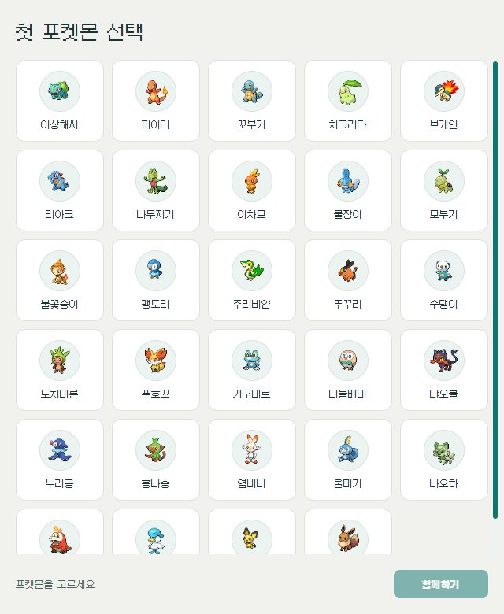

기능을 처음 쓸 때마다 튜토리얼이 그 자리를 짚어 줘요.

- 성장·포인트·파티·가방·진화 튜토리얼은 그 기능이 열릴 때 나와요.
- 도감·교환·사용자 튜토리얼은 그 화면을 처음 열 때 나와요.
- `✕` 로 닫으면 다시 나오지 않아요. 사용법은 설정의 `가이드북` 에서 다시 봐요.
- 탭 제목 옆의 `?` 를 누르면 그 탭의 팁이 말풍선으로 떠요. 말풍선의 `웹 가이드에서 더 보기` 는 이 설명서의 팁을 열어요.

## 놀이공간과 포켓몬

포켓몬은 화면의 놀이공간 안에서 놀아요. 앱 창은 테두리 없는 투명 창이고 항상 다른 창 위에 보여요.
포켓몬이 없는 곳을 누르면 뒤의 창이 눌려요.

- 가끔 걷고 두리번거려요. 입력이 없으면 잠들어요. 잠드는 시간은 설정의 `잠들기 기준` 으로 정해요(기본 5분).
- 콕 누르면 반응하고 울음소리를 내요. 놀아주기 쿨타임이 아니면 놀아 주기도 해요.
- 끌어서 옮길 수 있어요. 놓은 자리가 그 포켓몬의 집이 돼요. 들고 있는 동안에는 버둥거려요.
- 바탕화면에 나와 있는 포켓몬은 가끔 포인트·도구·진화용 도구·포켓몬을 주워 와요.
- 파티의 포켓몬 가운데 꺼내 둔 마리(최대 6마리)가 함께 나와요. `볼에 넣기` 를 하면 파티에 남은 채로 바탕화면에서만 사라져요. 같은 메뉴 자리의 `꺼내기` 로 다시 내보내요.

놀이공간은 설정 → `화면` 탭에서 골라요.

| 방식 | 뜻 |
|---|---|
| `모든 화면` | 모니터마다 포켓몬이 나뉘어 놀아요. 다른 모니터로 끌어다 놓으면 그 모니터로 옮겨 가요 |
| `한 화면` | 고른 모니터 하나에서 놀아요. 기본은 주 모니터예요 |
| `영역 지정` | 드래그로 그린 사각형 안에서 놀아요 |

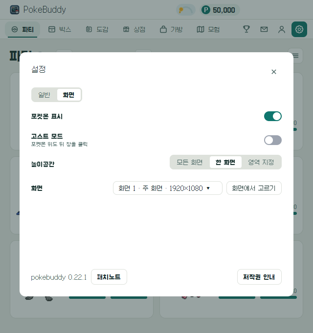

### 메뉴

포켓몬을 우클릭하면 그 포켓몬의 메뉴가 열려요. 맨 위에 이름과 상태 두 줄이 있고, 그 아래에 밥 주기, 놀아주기, 볼에 넣기, 상세 보기, 팔기가 있어요. 볼에 넣은 포켓몬은 `볼에 넣기` 대신 `꺼내기` 가 보여요. 모습을 고를 수 있는 포켓몬에는 `모습 바꾸기` 가 더 있어요. 지금 할 수 없는 항목은 흐리게 보여요. 설정창의 파티나 박스에서 포켓몬을 우클릭해도 메뉴가 열려요. 이 메뉴에는 상세 보기가 없어요. 포켓몬을 누르면 바로 상세가 열려요. 이 메뉴에는 `옮기기` 와 `교체` 가 더 있어요.
이유와 남은 시간은 메뉴에 적지 않아요.

트레이 메뉴에는 설정창 열기, 잠시 숨기기, 고스트 모드, 종료가 있어요. Windows 에서는 트레이 아이콘을 왼쪽 클릭해도 설정창이 열려요.

고스트 모드를 켜면 포켓몬 위를 눌러도 뒤의 창이 눌려요. 그동안 포켓몬을 옮기거나 만지지 못하고 우클릭도 안 돼요. 끌 때는 트레이 메뉴나 설정을 써요.

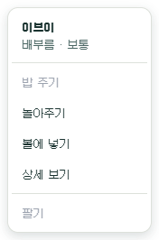

## 돌봄

포켓몬마다 만복도, 심심함, 친밀도가 있어요. 친밀도는 놀아 주기, 장난감, 프리미엄먹이로 오르고 줄지 않아요. 시간이 지나도 오르지 않아요. 대신 파티에 있는 동안 경험치가 저절로 쌓여요.

만복도는 시간이 지나면 줄고, 밥을 주면 올라요. 밥은 기본먹이를 줘요. 무료이고 개수 제한이 없어요. 밥을 줘도 친밀도는 오르지 않아요. 상점의 프리미엄먹이는 만복도를 가득 채우고, 2시간 동안 줄지 않게 해요. 친밀도가 조금 오르고 든든함 버프도 켜져요.

심심함은 일한 시간만큼 쌓여요. 연결한 CLI 가 작업하는 동안에는 더 빨리 쌓여요. 놀아 주면 심심함이 풀려요. 놀아 주면 포켓몬이 옆으로 조금 걸어가 그 자리에서 폴짝 뛰어요. 가방의 장난감을 쓰면 심심함이 0 이 돼요. 그 뒤에는 다시 쌓여요. 신남 버프도 2시간 켜져 포인트와 경험치가 더 빨리 쌓여요. 장난감은 놀아주기와 쿨타임을 같이 써요.

버프가 켜져 있으면 경험치와 포인트가 더 빨리 쌓여요. 친밀도가 낮아도 버프는 같아요.

밥 주기와 놀아주기의 쿨타임은 포켓몬마다 따로 세요. 장난감은 놀아주기 쿨타임(10분)을 같이 써요.

배가 고프거나 심심해지면 포켓몬이 말풍선을 띄워요. 배고프면 고기, 심심하면 장난감 공이 보여요. 배가 고프거나 심심한 동안에는 포인트가 덜 쌓여요. 배가 고픈 동안에는 경험치도 덜 쌓여요.

배고프지 않고 심심하지 않은 포켓몬은 무언가를 더 자주 주워 와요.

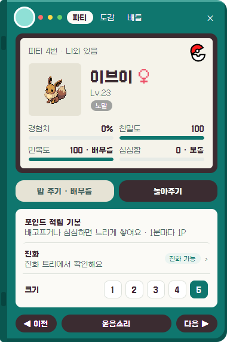

수치는 [밸런스 수치](specs/balance.md)에 있어요.

## 포인트와 상점

- 파티에 있는 포켓몬이 시간에 따라 포인트를 모아요. 친밀도가 높을수록 빨리 모아요. 볼에 넣은 파티 포켓몬도 모아요. 박스의 포켓몬은 모으지 않아요.
- 버프가 켜져 있으면 포인트를 더 빨리 모아요. 배가 고프거나 심심하면 더 느리게 모아요. 파티 상세의 `포인트 적립` 줄에서 지금 속도를 봐요.
- 상점은 `알`·`도구`·`진화`·`파티` 로 나뉘어요. `파티` 에서는 파티 칸과 파티 프리셋을 팔아요. 산 도구는 가방에 들어가요.
- 가방에서 도구를 골라 대상 포켓몬에게 써요.
- 쓰지 않을 도구는 가방에서 팔아요. 도구를 고르고 `판매`를 눌러요. 구매가의 60%를 포인트로 받아요. 기본먹이와 돌아오는 약은 팔 수 없어요.
- 바탕화면에 나와 있는 포켓몬은 가끔 포인트·도구·진화용 도구·포켓몬을 주워 와요. 주우면 `줍기` 알림 배너가 떠요. 규칙은 [줍기](specs/game.md#줍기)에 있어요.

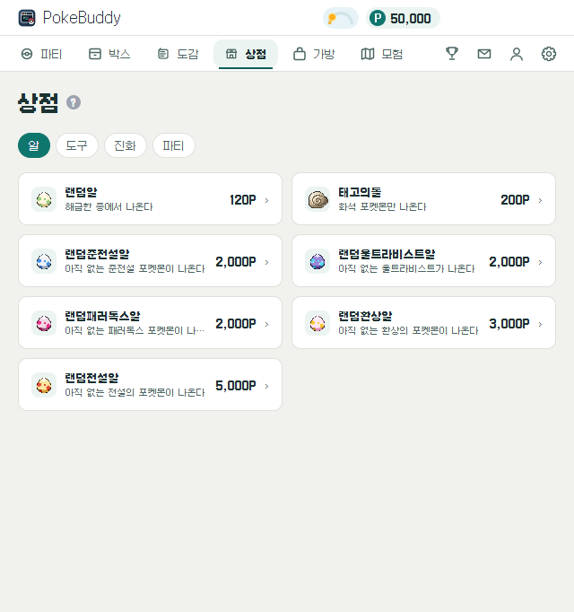

### 포인트가 들어오는 곳

포인트는 아래 경로로 들어와요.

| 경로 | 언제 | 얼마 |
|---|---|---|
| 시간 적립 | 앱이 켜져 있는 동안 파티의 포켓몬마다 | 1마리 기본 2분에 1P. 친밀도와 돌봄에 따라 바뀌어요(아래) |
| 다른 프리셋 | 적용하지 않은 프리셋의 포켓몬마다 | 시간 적립의 `20 + 친밀도 ÷ 10` %(20~30%). 버프와 손해를 받지 않아요 |
| 줍기 | 바탕화면에 나온 포켓몬이 가끔 | 주운 것이 포인트면 5~10P |
| 랜덤 배틀 | 판이 끝날 때 | 그날 첫 판 500P, 그 뒤 이기면 50P, 지거나 비기면 10P. 5분에 한 번 |
| 업적 보상 | 업적창에서 보상을 받을 때 | 업적마다 100~1,500P |
| 도구 판매 | 가방에서 도구를 팔 때 | 구매가의 60% |
| 포켓몬 판매 | 박스에서 포켓몬을 팔 때 | 그 종이 나오는 알 값의 25%. 랜덤알 종 30P, 태고의돌 종 50P |
| 우편함 선물 | 운영자가 보낸 편지를 받을 때 | 편지마다 달라요. 로그인한 계정만 받아요 |
| 시작 포인트 | 첫 포켓몬을 고를 때 한 번 | 120P |

#### 시간 적립

- 포켓몬 1마리가 1P 를 얻는 간격은 `2분 ÷ 친밀도 배수 ÷ 적립 배율` 이에요.
- 친밀도 배수는 `1 + 친밀도 ÷ 100` 이에요. 친밀도 0 이면 1배, 50 이면 1.5배, 100 이면 2배예요.
- 적립 배율은 `100% + 버프 − 손해` 예요. 곱하지 않고 더해요. 가장 낮아도 10% 예요.
  - 버프: 든든함(프리미엄먹이) +80%, 신남(장난감) +30%. 각각 2시간이에요.
  - 손해: 배고픔 −30%, 매우 배고픔 −60%, 심심해 −10%, 지루해 −20%. 배고픔과 심심함의 손해는 더해요.
- 파티 상세 기기 창의 `포인트 적립` 줄 설명 끝에 그 포켓몬의 지금 간격이 `· 38초마다 1P` 처럼 붙어요.
- 볼에 넣어 바탕화면에서 숨긴 포켓몬도 똑같이 모아요. 박스의 포켓몬은 모으지 않아요.
- 여러 마리가 모은 몫은 합쳐서 들어와요. 파티 6마리가 모두 친밀도 100 이고 버프·손해가 없으면 10초에 1P 꼴이에요.
- 시간은 앱이 켜져 있고 PC 가 잠기지 않았을 때만 흘러요. 앱을 끈 동안과 잠금·절전 중에는 쌓이지 않아요. 나중에 몰아서 주지도 않아요.
- 연결한 AI 코딩 도구가 일하는 시간은 포인트를 더 주지 않아요.

| 1마리의 상태 | 1P 간격 | 시간당 |
|---|---|---|
| 친밀도 0, 버프·손해 없음 | 2분 | 30P |
| 친밀도 50 | 80초 | 45P |
| 친밀도 100 | 1분 | 60P |
| 친밀도 100, 장난감 | 약 46초 | 78P |
| 친밀도 100, 프리미엄먹이 | 약 33초 | 108P |
| 친밀도 100, 장난감과 프리미엄먹이 | 약 29초 | 126P |
| 친밀도 100, 매우 배고픔 | 2분 30초 | 24P |
| 다른 프리셋, 친밀도 100 | 3분 20초 | 18P |

#### 줍기

- 바탕화면에 나와 있는 포켓몬마다 1초에 1/3000 확률로 무언가를 주워 와요. 배고프지 않고 심심하지 않은 포켓몬은 1/2000 이에요.
- 주운 것은 포인트 약 58%, 도구 약 29%, 진화용 도구 약 12%, 포켓몬 1% 미만이에요. 포인트는 5~10P 예요.
- 잘 돌본 포켓몬 1마리를 8시간 꺼내 두면 포인트를 약 8번 주워 와요.
- 볼에 넣은 포켓몬, 다른 프리셋의 포켓몬, 잠든 포켓몬은 줍지 않아요. 포켓몬 표시를 끈 동안에도 줍지 않아요. 포켓몬은 입력이 없으면 잠들어요(설정 `잠들기 기준`).

## 알과 부화

1. 상점에서 알을 사요. 알은 돌보미집에 들어가요. 돌보미집은 박스 탭 넘김 줄의 집 아이콘 단추로 열어요. 단추는 `정렬` 왼쪽에 있어요. 부화할 수 있는 알이 있으면 단추에 점이 떠요. 돌보미집에는 알을 6개까지 둬요.
2. 알마다 준비 시간이 따로 흘러요. 준비가 끝나면 알림 배너가 떠요.
3. 돌보미집에서 알을 직접 열어요. 부화 결과 창이 태어난 포켓몬을 보여 줘요. `확인` 을 누르면 돌보미집으로 돌아가요. 스페이스바나 Enter 를 눌러도 돼요. `모두 열기` 를 누르면 준비된 알을 한꺼번에 열고 결과를 하나씩 보여 줘요.
4. 파티에 빈 칸이 있으면 파티에 들어가 바로 나와요. 빈 칸이 없으면 박스에 들어가요.

알에서 나오는 종과 확률은 상점에서 구매 전에 확인해요.

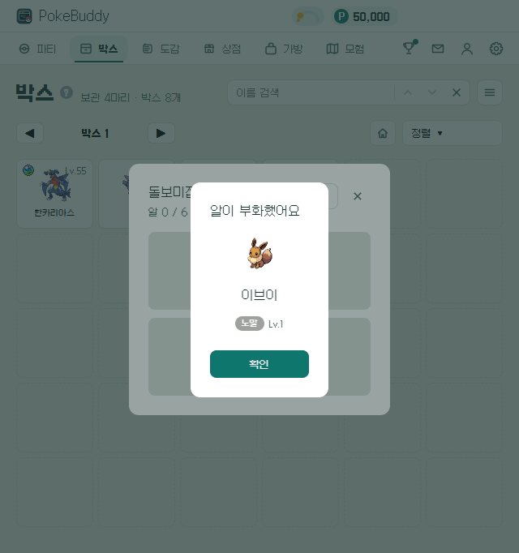

## 성장과 진화

- 파티에 있는 포켓몬은 10분마다 경험치가 1,000씩 저절로 올라요. 배고프면 덜 오르고 신남·든든함이 켜져 있으면 더 올라요. 박스의 포켓몬은 오르지 않아요.
- 경험사탕과 이상한사탕으로 더 빨리 올려요. 상점은 경험사탕 L·XL 과 이상한사탕을 팔아요. 가방에 남은 XS·S·M 은 그대로 쓰고 팔 수 있어요. 최대 레벨은 100이에요.
- 진화 조건을 채우면 알림 배너가 떠요. 진화는 파티 상세 기기 창에서 직접 해요. 자동으로 진화하지 않아요.
- 돌로 진화하는 종은 진화의돌을, 교환으로 진화하는 종은 `연결의끈` 을 써요.
- 알로라 라이츄처럼 다른 지방의 모습으로 진화하려면 `지도` 를 써요. 돌로 진화하는 포켓몬은 돌 대신 지도를 써요. 예: 피카츄는 천둥의돌로 라이츄, 지도로 알로라 라이츄가 돼요. 레벨로 진화하는 포켓몬은 그 레벨이 되고 지도가 있어야 해요. 지도는 상점의 진화 탭에서 사요.
- 이로치 포켓몬도 있어요. 이로치 포켓몬은 이름 옆이나 칸 왼쪽 위에 빨간 별 아이콘으로 표시해요.

파티나 박스의 포켓몬을 누르고 메뉴의 `상세 보기` 를 고르면 설정창 옆에 파티 상세 기기 창이 붙어 열려요. 돌봄·진화·크기를 여기서 해요. `도감 보기` 를 누르면 이 창 옆에 그 포켓몬의 도감 기기 창이 열려요. 다시 누르면 닫혀요.
`◀ 이전`·`다음 ▶` 이나 방향키로 다음 포켓몬으로 넘겨요. 같은 포켓몬을 다시 누르거나, 탭을 바꾸거나, Esc 를 누르면 닫혀요.

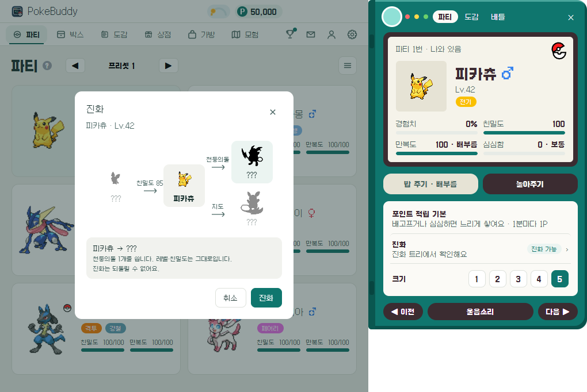

## 파티와 박스

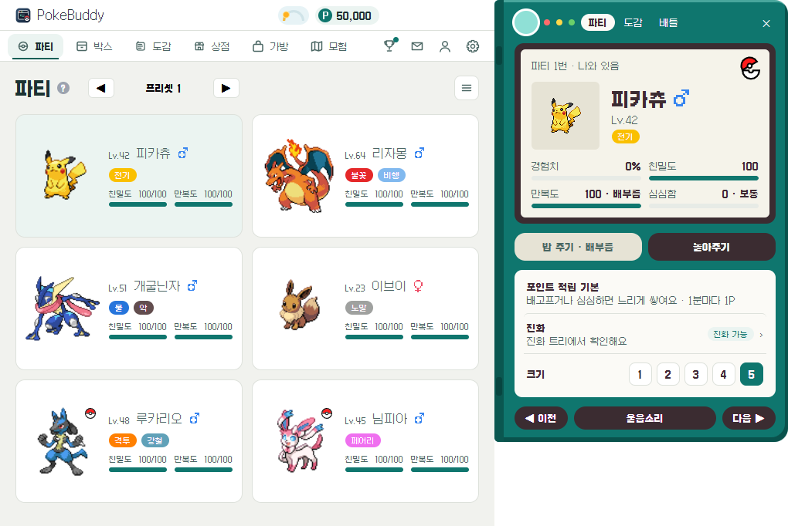

- 새 게임의 파티는 2칸이에요. 상점의 파티 칸 구매와 파티 칸 업적 보상으로 최대 6칸까지 열어요. 파티 칸은 500P 예요.
- 파티 프리셋은 파티 칸 여섯 개의 묶음이에요. 프리셋마다 다른 포켓몬을 넣어 둬요. 2개로 시작하고 상점에서 3개를 더 사요. 프리셋은 1000P 예요. 가진 프리셋의 칸을 모두 열어야 다음 프리셋을 사요.
- 파티 탭 위쪽의 `◀`·`▶` 를 누르면 앞·뒤 프리셋으로 바뀌어요. 바탕화면의 포켓몬도 그 프리셋의 포켓몬으로 바뀌어요. 다른 프리셋의 포켓몬은 포인트만 20~30% 속도로 모아요. 경험치·만복도·심심함은 멈춰요.
- 프리셋 이름을 누르면 이름을 바꿔요. 이름은 8자까지예요.
- 파티 탭 오른쪽 위 메뉴(☰)의 `전체보기` 를 누르면 가진 프리셋을 한 줄씩 모아 봐요. 줄을 누르면 그 프리셋으로 바뀌어요.
- 파티 칸은 프리셋마다 따로 열어요. 상점의 파티 칸은 지금 프리셋의 칸을 먼저 열어요. 지금 프리셋의 칸을 다 열었으면 칸이 남은 다른 프리셋의 칸을 바로 열어요. 상품에 칸이 열릴 프리셋 이름이 보여요. 둘째 프리셋부터는 2칸으로 시작하고 나머지 4칸을 상점에서 사요.
- 포켓몬 한 마리는 한 프리셋에만 넣어요.
- 파티 밖의 포켓몬은 박스에 보관해요. 박스 하나는 30칸이에요. 박스는 8개로 시작해요. 상점 `파티` 분류의 `박스 +1`(300P)로 하나씩 늘려요. 최대 64개예요.
- 박스 순서는 박스 탭 오른쪽 위 메뉴 단추의 `박스 순서`에서 바꿔요. 박스 타일을 끌어 다른 타일에 놓아요. 타일을 누르면 그 박스로 가요.
- 파티와 박스에 빈 칸이 없으면 알을 열 수 없어요. 포켓몬 보상도 받을 수 없어요. 우편의 포켓몬은 박스에만 들어가요. 박스에 빈 칸이 모자라면 파티에 빈 칸이 있어도 받을 수 없어요. 박스를 사거나 포켓몬을 판 뒤 다시 해요.
- 박스 이름을 누르면 이름을 바꿔요. 이름은 8자까지예요.

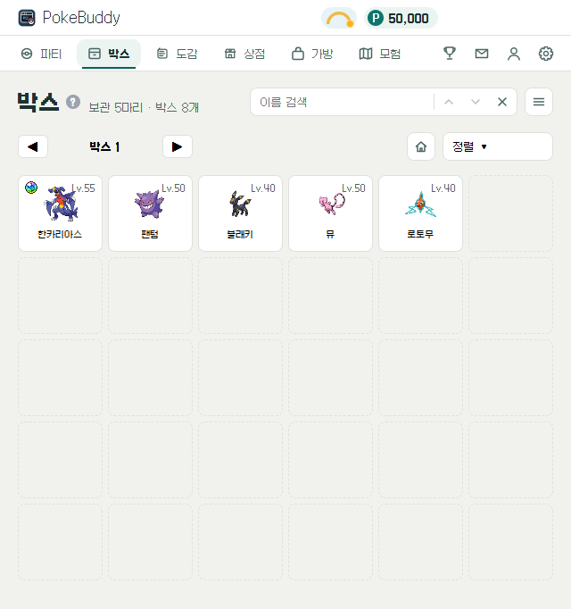

- 박스의 포켓몬을 우클릭하고 `옮기기` 를 누르면 그 포켓몬이 커서에 들려요. 원래 칸은 흐려져요. 다른 포켓몬을 누르면 자리를 맞바꾸고, 빈 칸을 누르면 그 칸에 놓아요. `◀`·`▶` 를 누르면 든 채로 다른 박스로 넘어가요. 다른 곳을 누르거나 Esc 를 누르면 취소해요. 같은 박스 안에서는 끌어서 자리를 바꿀 수도 있어요. 다른 박스로 보낼 때는 `옮기기` 를 써요.
- 박스 탭 위쪽의 찾기 줄에 포켓몬 이름을 넣으면 1초 뒤 모든 박스에서 찾아요. Enter 를 누르면 바로 찾아요. 찾은 포켓몬이 있는 박스로 넘어가고 그 칸이 옅게 칠해져요. `2/3` 처럼 몇 번째 결과인지 보여요. `^`·`v` 나 Enter 로 다른 결과로 옮기고 `✕` 로 지워요. 파티 프리셋에 든 포켓몬은 찾지 않아요.
- 박스의 포켓몬을 우클릭하고 `팔기` 를 누르면 포인트를 받고 그 포켓몬을 보내요. 파티 프리셋에 든 포켓몬은 팔 수 없어요. 팔려면 먼저 박스로 옮겨요. 랜덤알에서 나오는 포켓몬은 30P, 태고의돌에서 나오는 포켓몬은 50P 예요. 판 포켓몬은 되돌릴 수 없어요. 전설의 포켓몬처럼 한 번만 얻는 포켓몬, 업적으로 받은 포켓몬, 마지막 한 마리는 팔 수 없어요. 배틀 파티에 든 포켓몬과 교환에 올린 포켓몬도 팔 수 없어요.
- 파티 탭 오른쪽 위 메뉴(☰)의 `교체` 나 빈 파티 칸을 누르면 파티 교체 모달이 열려요. 왼쪽은 포켓몬 고르기 판이고, 오른쪽은 지금 프리셋의 파티 6칸이에요.
  - 오른쪽에서 바꿀 칸을 먼저 눌러요. 그다음 왼쪽 판의 포켓몬을 누르면 그 칸에 넣어요. 칸에 포켓몬이 있으면 두 포켓몬을 맞바꿔요.
  - 다른 프리셋에 든 포켓몬도 골라서 데려와요.
  - 칸을 고르고 판의 박스 빈 칸을 누르면 그 칸의 포켓몬을 박스에 보관해요.
  - `모두 박스로` 는 지금 파티를 모두 박스에 보관해요. `완료` 로 닫아요.

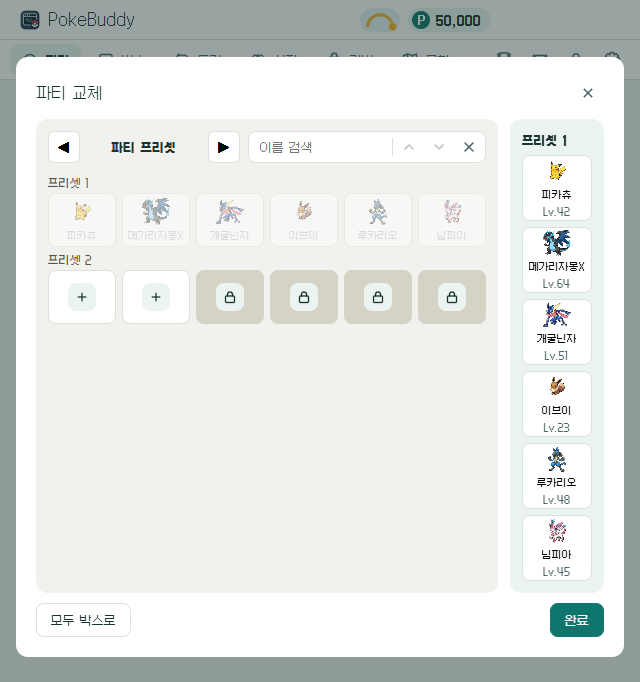

- 리자몽·팬텀처럼 메가진화하는 포켓몬은 조건을 채우면 메가스톤이 생겨요. 조건은 친밀도 100, Lv.60 이상, 친밀도 100 뒤 파티에서 24시간, 친밀도 100 뒤 놀아주기 30번이에요. 장난감을 쓴 것도 놀아주기로 세요. 밥 주기는 세지 않아요. 메가스톤이 생기면 알림이 떠요.
- 메가스톤이 생긴 포켓몬을 파티에 두고 누르면 상세 창의 그림 오른쪽 아래에 메가스톤이 보여요. 메가스톤을 누르면 메가진화해요. 다시 누르면 원래 모습으로 돌아가요. 한 파티 프리셋에서 여러 마리가 메가진화할 수 있어요. 적용하지 않은 프리셋의 포켓몬도 메가진화해요. 박스로 옮기면 원래 모습으로 돌아가요.
- 코스모그처럼 모습을 고를 수 있는 포켓몬은 박스 칸에 모습들이 2×2 로 보여요. 칸을 우클릭하면 뜨는 메뉴에서 `모습 바꾸기` 를 누르고, 옆에 뜨는 말풍선에서 모습을 골라요.

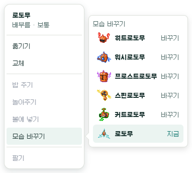

## 도감과 업적

- 도감에서 전체 종의 등록 상태, 얻는 방법, 진화 조건을 봐요. 해금하지 않은 종은 그림이 보이지 않아요.
- 도감과 상점 포켓몬 탭은 검색 줄 오른쪽의 토글(`‹ ›` 쪽, 위아래 꺾쇠 스크롤)로 보는 방식을 골라요. 쪽 방식은 한 쪽에 도감 30칸, 상점 15칸씩 보이고 `◀`·`▶` 로 쪽을 넘겨요. 도감에서 획득한 포켓몬은 칸 왼쪽 위에 몬스터볼 아이콘이 있어요. 이로치를 획득한 포켓몬은 몬스터볼 옆에 이로치 아이콘이 있어요. 스크롤 방식은 전부 이어서 보이고 스크롤해서 봐요. 고른 방식은 탭마다 따로 기억해요.
- 검색 칸에 이름이나 번호를 넣으면 1초 뒤 목록을 걸러요. Enter 를 누르면 바로 걸러요. `✕` 로 검색어를 지우면 전체 목록으로 돌아가요.
- 알로라 라이츄 같은 리전폼은 기본형과 따로 한 칸을 차지해요. 번호는 `026-1` 처럼 도감 번호 뒤에 폼 순번을 붙여요. 검색 칸에 `26-1` 을 넣으면 그 칸만 찾아요.
- 도롱충이의 모래땅도롱, 비비용 무늬, 로토무의 다섯 모습처럼 리전폼이 아닌 다른 모습은 따로 칸이 없어요. 도감 기기 창의 `모습` 줄에서 `다른 모습 n` 을 누르거나 바닥 줄 가운데의 점을 누르면 2쪽에서 모아 봐요. 얻지 못한 모습은 검은 실루엣이에요.
- 울음소리는 도감 기기 창 초상 오른쪽 위의 음표 단추로 내요. 이로치를 얻은 종은 그 아래 이로치 단추로 이로치 모습을 봐요.

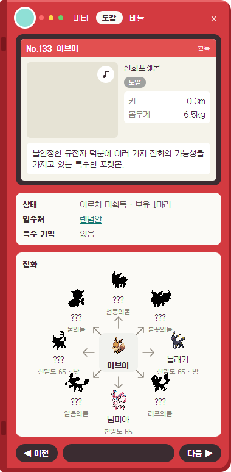

- 플라엣테(영원의 꽃)와 다투곰(붉은 달)은 상점 진화 분류의 영원의 꽃·붉은 달(3,000P)을 사 두고 플라엣테·다투곰의 포켓몬 메뉴에서 `모습 바꾸기`를 고르면 돼요. 원래 모습으로는 돌아가지 않아요. 메가플라엣테는 플라엣테(영원의 꽃)만 메가진화해요.
- 설정창 머리의 포인트 왼쪽에 낮·밤 게이지가 있어요. 해(밤에는 달)가 반원을 따라 움직이며 지금 시간대가 얼마나 지났는지 보여요. 가리키면 남은 시간이 보여요.
- 게임 시간은 10분마다 낮과 밤이 바뀌어요. 매시 0~10·21~30·41~50분이 낮, 11~20·31~40·51~59분이 밤이에요. 시간대가 맞지 않으면 파티 상세의 진화 줄에 `밤에 진화(현재 : 낮 · 8분 뒤 밤)` 처럼 남은 시간이 보여요.
- 암멍이는 Lv.25 에서 진화해요. 낮에는 루가루암, 밤에는 루가루암(한밤중의 모습)이 돼요. 친밀도가 100 이면 낮과 밤에 관계없이 루가루암(황혼의 모습)도 고를 수 있어요. 일레즌은 Lv.30 에서 스트린더와 스트린더(로우한 모습) 가운데 골라요.
- 치고마는 족자로 우라오스가 돼요. 진화하면 두 태세를 모두 받고 `모습 바꾸기`로 오가요.
- 알에서 배쓰나이가 나올 때 모습이 정해져요. 적색근 45%, 청색근 45%, 백색근 10% 예요. 배쓰나이(백색근의 모습)만 대쓰여너로 진화해요. 대쓰여너는 암컷과 수컷의 그림이 달라요.
- 디아루가·펄기아·기라티나는 `모습 바꾸기`로 오리진폼이 돼요. 처음 바꿀 때 도감 기기 창 2쪽에 남아요.
- 마기아나(500년 전의 색)와 피츄(삐쭉귀)는 업적 보상으로 얻어요. 한 번만 얻을 수 있어요. 뮤, 토게피, 아르세우스, 메타몽, 라프라스, 로토무도 업적 보상으로만 얻어요. 로토무는 연결한 AI 코딩 도구가 처음 일을 하면 받아요. 아르세우스는 디아루가·펄기아·기라티나를 모두 얻으면 받아요. 마기아나(500년 전의 색)는 볼케니온과 마기아나를 모두 얻으면 받아요. 업적 보상 포켓몬은 한 번만 얻고, 팔거나 교환할 수 없어요.
- 업적은 44개예요. 업적을 달성하면 알림 배너가 떠요. 배너의 `바로가기` 나 헤더의 업적창에서 보상을 받아요. 보상은 파티 칸, 포켓몬, 포인트, 알, 도구 가운데 하나예요.
- 업적창 위쪽의 칩(`전체`·`도감`·`육성`·`알`·`탐색`·`함께`)으로 분류를 골라요. 달성하지 않은 업적은 이름 아래의 막대와 `현재 / 기준` 으로 진행도를 보여요.
- 알 보상은 돌보미집에 빈 칸이 있어야 받아요. 포켓몬 보상은 파티나 박스에 빈 칸이 있어야 받아요.

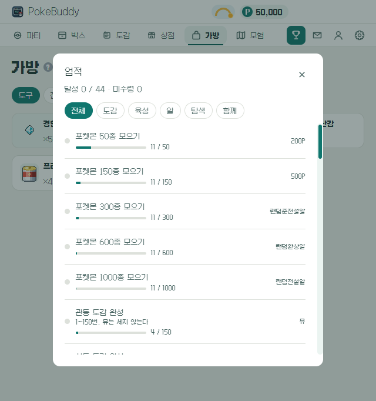

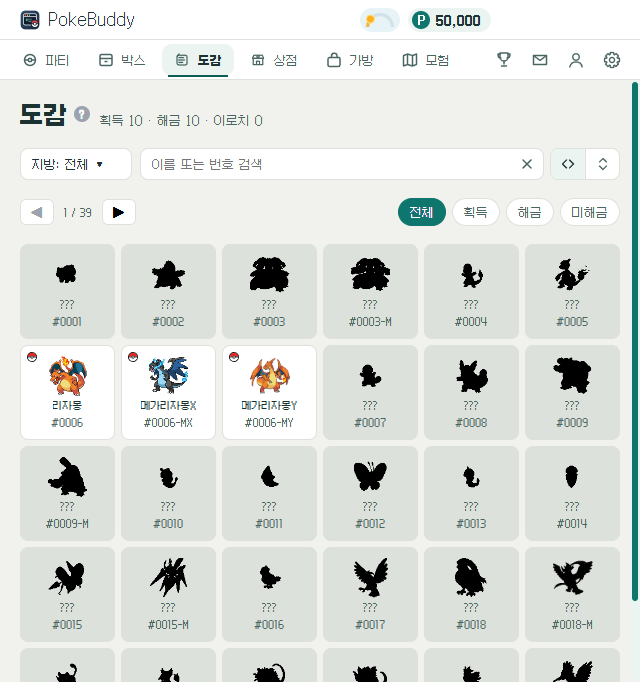

## 친구 교환

1. 설정창 박스 탭 오른쪽 위 메뉴 단추를 누르고 `교환`을 골라요. 교환 모달이 떠요.
2. `공유 채널 만들기` 의 `링크 만들기` 를 누르고 나온 교환 링크를 친구에게 보내요.
3. 친구는 그 링크를 눌러요. 브라우저가 앱을 열지 물으면 `열기` 를 눌러요. 앱이 켜지고 교환 모달이 떠요.
4. 두 사람이 왼쪽 `보낼 포켓몬` 에서 한 마리씩 고르고 `확정` 을 눌러요. 확정한 쪽의 카드는 바탕색이 바뀌어요. 두 사람이 모두 확정하면 바뀌어요.

- 링크를 눌러도 앱이 열리지 않으면 링크를 복사해 교환 모달의 `링크로 참가` 에 붙여 넣어요.

- 교환은 로그인한 계정만 해요. 로그인하지 않았으면 교환 모달에 `로그인` 단추가 보여요. 이 단추를 누르면 `계정` 탭이 열려요.
- 교환에 올리는 포켓몬은 계정 저장에 있어야 해요. 아직 올리지 않은 포켓몬이면 저장이 끝난 뒤 다시 올려요.
- 교환으로 보낸 포켓몬은 다시 교환할 수 없어요. 백업으로 되돌린 저장도 같아요.
- 다른 교환에 올라가 있는 포켓몬은 올릴 수 없어요. 다른 계정의 교환이어도 같아요. 그 교환에서 다른 포켓몬으로 바꾸거나 그 교환이 닫히면 다시 올릴 수 있어요.
- 교환으로 보낸 포켓몬이 남은 저장은 계정에 올리지 않아요. 이때 서버 저장을 올릴 수 있으면 앱은 서버 저장으로 바꿔요. 이 PC 진행은 백업 파일로 남겨요.
- 서버 저장도 올릴 수 없으면 앱은 저장을 바꾸지 않고 올리기를 멈춰요. `계정` 탭에 이유가 보여요.
- 교환 링크는 한 번 쓰면 끝나요.
- 교환 모달을 닫아도 교환은 이어져요. 교환 중이면 박스 탭의 메뉴 단추에 점이 보여요.
- 교환해도 진화하지 않아요. 교환 진화 종은 `연결의끈` 으로 진화해요.

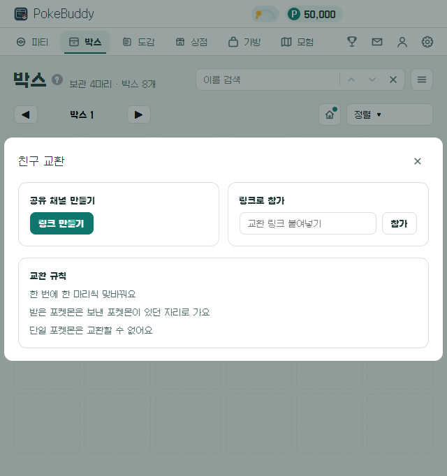

## 모험과 배틀

설정창의 `모험` 탭에서 배틀 파티를 짜고 다른 사용자와 배틀해요. 포켓몬은 스스로 싸워요. 탐험은 아직 없어요.

- 배틀 파티는 배틀에만 쓰는 6칸 파티예요. 바탕화면의 파티 프리셋과 따로예요. 프리셋에 든 포켓몬도 넣을 수 있어요. 포켓몬을 옮기지 않으므로 원래 자리는 그대로예요.
- 머리 오른쪽 메뉴(☰)의 `가져오기` 는 파티 프리셋 하나를 배틀 파티로 복사해요. `교체` 는 배틀 파티 교체 모달을 열어요. 빈 칸을 눌러도 같아요.
- 칸 순서는 끌어서 바꾸거나, 칸을 우클릭하고 `옮기기` 를 누른 뒤 다른 칸을 눌러 바꿔요.
- 칸을 누르면 배틀 파티 상세 기기 창이 열려요. 능력치·특성·기술을 보고 메가진화를 켜요.
- 배틀은 6대6 실시간 오토배틀이에요. 0.1초마다 포켓몬이 스스로 움직이고 기술을 써요. 사용자가 조작할 것은 없어요.
- 배틀은 모두 레벨 50 으로 계산해요. 레벨이 낮아도 배틀에 낼 수 있어요.

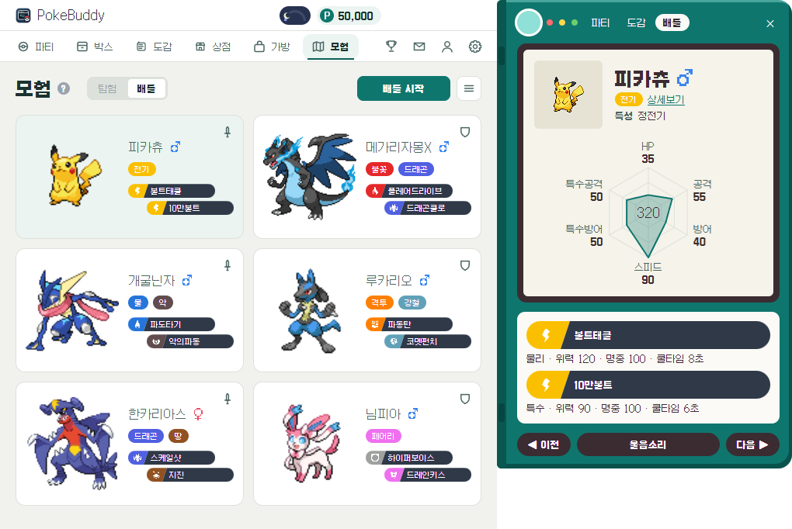

### 배틀 시작

첫 파티 프리셋의 6칸을 모두 열어야 배틀해요. 다른 프리셋의 칸은 보지 않아요.

머리의 `배틀 시작` 을 누르고 방식을 골라요.

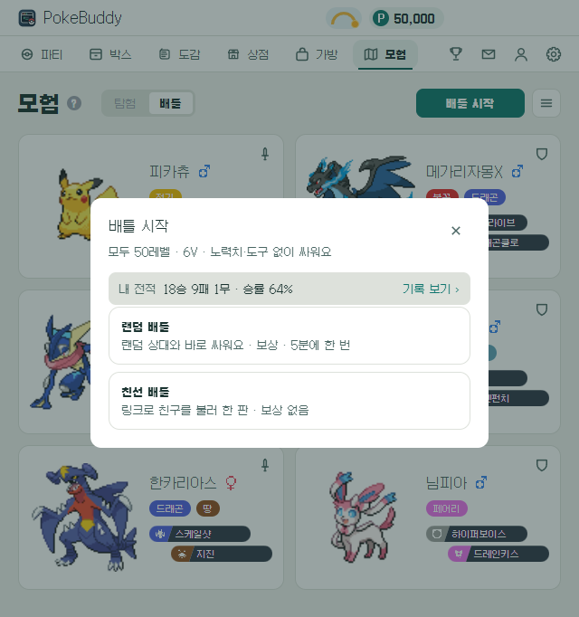

| 방식 | 상대 | 보상 |
|---|---|---|
| `랜덤 배틀` | 상대를 고르지 않아요. 누르면 서버가 바로 상대를 정해요. 배틀 파티 6칸을 다 채운 다른 사용자가 있으면 절반은 그 사용자의 파티, 절반은 서버의 샘플 파티예요. 그런 사용자가 없으면 샘플 파티와 싸워요. 배틀 파티 6칸을 다 채워야 다른 사람의 상대로 나와요 | 그날 첫 배틀 500P, 그 뒤 이기면 50P, 지거나 비기면 10P. 샘플 파티와 싸워도 같아요. 5분에 한 번 |
| `친선 배틀` | 링크로 부른 친구. 둘 다 `준비` 를 누르면 시작해요 | 없음. 쿨타임도 없어요 |

- 친선 배틀은 로그인한 계정만 해요. 링크 규칙은 친구 교환과 같아요.
- 하루는 한국 시간 0시에 바뀌어요.
- 배틀 시작 창의 `기록 보기 ›` 에서 최근 배틀과 승패를 봐요.
- 배틀이 시작되면 바탕화면의 포켓몬이 잠시 숨고 배틀 창이 떠요. 배틀 창을 닫으면 다시 나와요.

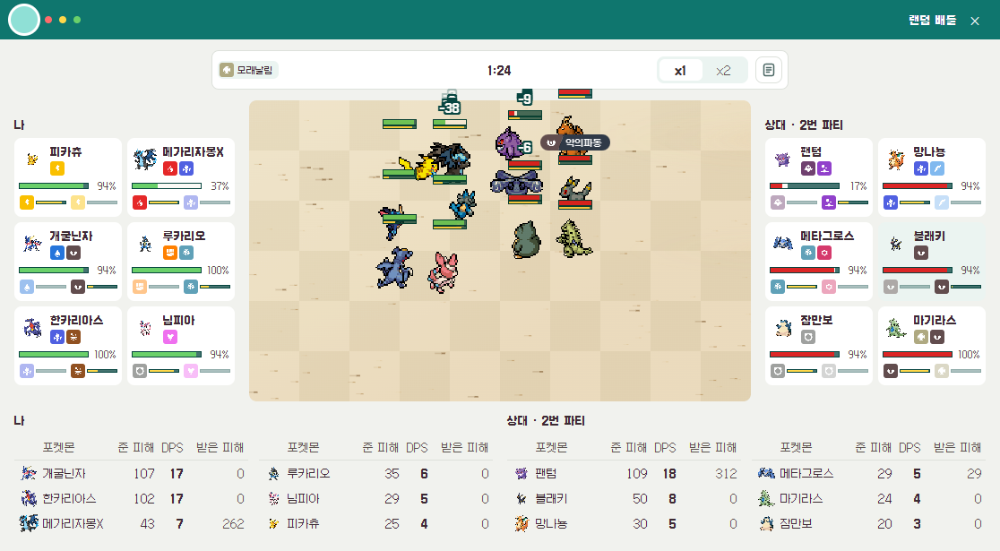

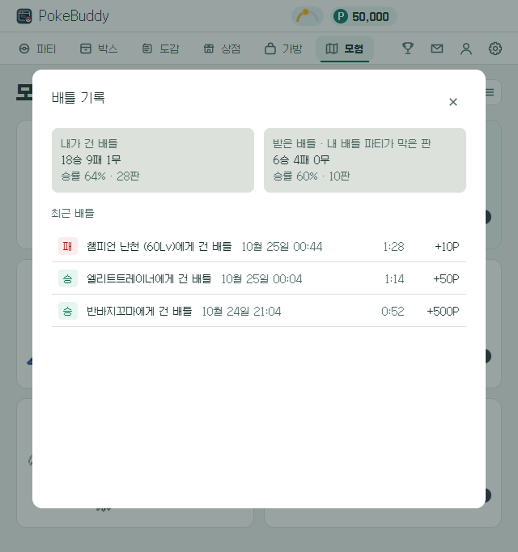

### 출전 제한

한 배틀 파티에는 등급마다 낼 수 있는 수가 정해져 있어요. 넘는 포켓몬은 `출전 불가` 로 보이고, 출전 불가가 있으면 배틀을 시작하지 못해요.

| 등급 | 수 |
|---|---|
| 초전설(뮤츠·루기아·아르세우스 등) | 1마리 |
| 초전설과 준전설(환상·준전설·울트라비스트·패러독스)을 합친 수 | 3마리 |
| 메가진화(원시회귀 포함) | 1마리 |

초전설 1마리와 준전설 2마리를 낼 수 있어요. 초전설 없이 준전설만 3마리를 낼 수도 있어요.

- 수를 넘으면 칸 순서가 뒤인 포켓몬이 출전 불가예요.
- 진화 전·후 모습은 같은 등급으로 세요.

### 기술

- 포켓몬마다 기술 2개로 싸워요. 1번 → 2번 → 1번 순서로 번갈아 써요. 차례가 온 기술이 준비되지 않았으면 기다려요.
- 기기 창의 기술 칸을 누르면 기술 바꾸기 모달이 열려요. 오른쪽에서 바꿀 칸을 누르고 왼쪽 목록에서 기술을 눌러요. 진화한 포켓몬은 고를 수 있는 기술이 더 많아요.
- 두 기술 사이의 단추로 순서를 바꿔요.
- 사거리는 칸으로 정해요. 앞 열(2·4·6번 칸)은 사거리 1 이라 붙어서 싸워요. 뒤 열(1·3·5번 칸)은 사거리 3 이라 멀리서 싸워요. 기술이 물리인지 특수인지와는 관계없어요.

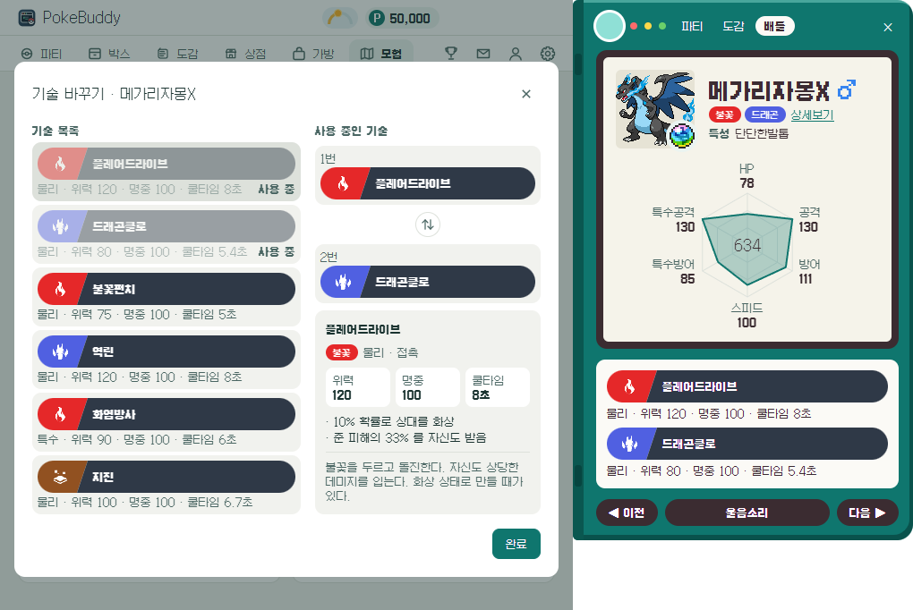

## 팁

게임을 빨리 키우는 공략을 모았어요. 숫자는 지금 앱(0.22.1)의 규칙 그대로예요.

### 포인트 잘 버는 법

친밀도 100 인 포켓몬으로 파티 6칸을 채우고, 1시간 안에 한 번씩 돌보는 것이 기본이에요.

1. 파티 칸을 6칸까지 열어요. 포켓몬은 마리마다 따로 포인트를 모아요.
2. 파티 포켓몬의 친밀도를 100 으로 올려요. 친밀도 100 이면 친밀도 0 보다 2배 빨리 모아요. 방법은 [친밀도 빨리 올리는 법](#친밀도-빨리-올리는-법)에 있어요.
3. 1시간 안에 한 번씩 밥을 주고 놀아 줘요. 배가 고프거나 심심하면 10~60% 느려지고, 둘이 겹치면 최대 80% 느려져요.
4. 프리미엄먹이(50P)와 장난감(20P)을 함께 써요. 2시간 동안 적립이 +80%, +30% 빨라져요.
5. 하루 첫 랜덤 배틀을 해요. 이기든 지든 500P 예요.
6. 다른 파티 프리셋도 친밀도를 올린 포켓몬으로 채워요. 적용하지 않은 프리셋도 20~30% 속도로 모아요.
7. 업적 보상을 챙기고, 쓰지 않는 도구와 남는 포켓몬을 팔아요.

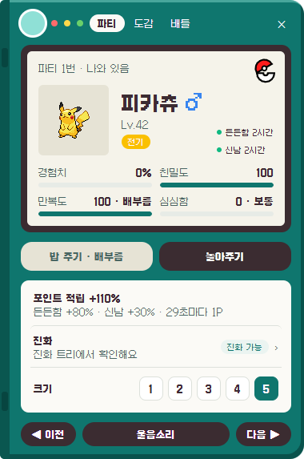

켜 두는 시간별 예시예요. 친밀도 100 파티 6마리를 손해 없이 돌본 경우이고, 도구 값은 뺐어요.

| 쓰는 도구 | 1마리 시간당 | 6마리 시간당 | 하루 2시간 | 하루 8시간 |
|---|---|---|---|---|
| 없음 | 60P | 360P | 720P | 2,880P |
| 장난감 | 78P | 408P | 816P | 3,264P |
| 프리미엄먹이 | 108P | 498P | 996P | 3,984P |
| 둘 다 | 126P | 546P | 1,092P | 4,368P |

- 여기에 그날 첫 랜덤 배틀 500P 가 더해져요.
- 6마리를 모두 바탕화면에 꺼내 두면 줍기로 시간당 약 47P 를 더 주워 와요.
- 다른 프리셋 4개를 친밀도 100 포켓몬으로 채우면 시간당 432P 를 더 모아요(1마리 18P × 24마리).
- 랜덤 배틀은 하루 횟수 제한이 없어요. 5분마다 한 판씩 할 수 있고, 이기면 50P, 지거나 비기면 10P 예요.

| 그 밖에 들어오는 곳 | 얼마 |
|---|---|
| 줍기 | 잘 돌본 1마리가 시간당 약 1번 포인트를 주워 와요. 한 번에 5~10P |
| 도구 판매 | 구매가의 60%. 예: 프리미엄먹이 30P, 이상한사탕 120P |
| 포켓몬 판매 | 랜덤알 종 30P, 태고의돌 종 50P |
| 업적 | 포인트 보상 업적 25개, 모두 합해 15,700P |

자세한 규칙은 [포인트와 상점](#포인트와-상점)에 있어요.

### 친밀도 빨리 올리는 법

장난감을 10분마다 쓰는 것이 가장 빨라요.

| 방법 | 오르는 양 | 0 → 100 |
|---|---|---|
| 장난감만 | +5 | 20개, 약 3시간 10분, 400P |
| 놀아주기만 | +3 | 34번, 5시간 30분, 무료 |
| 프리미엄먹이 | +2 | 친밀도용으로는 약해요 |

1. 새로 데려온 포켓몬에게 장난감을 써요.
2. 10분 뒤 다시 써요. 놀아주기와 장난감은 쿨타임 10분을 같이 써서, 둘을 섞어도 빨라지지 않아요.
3. 장난감이 없으면 놀아 줘요. 놀아주기도 신남 버프는 켜지지 않지만 친밀도는 +3 올라요.

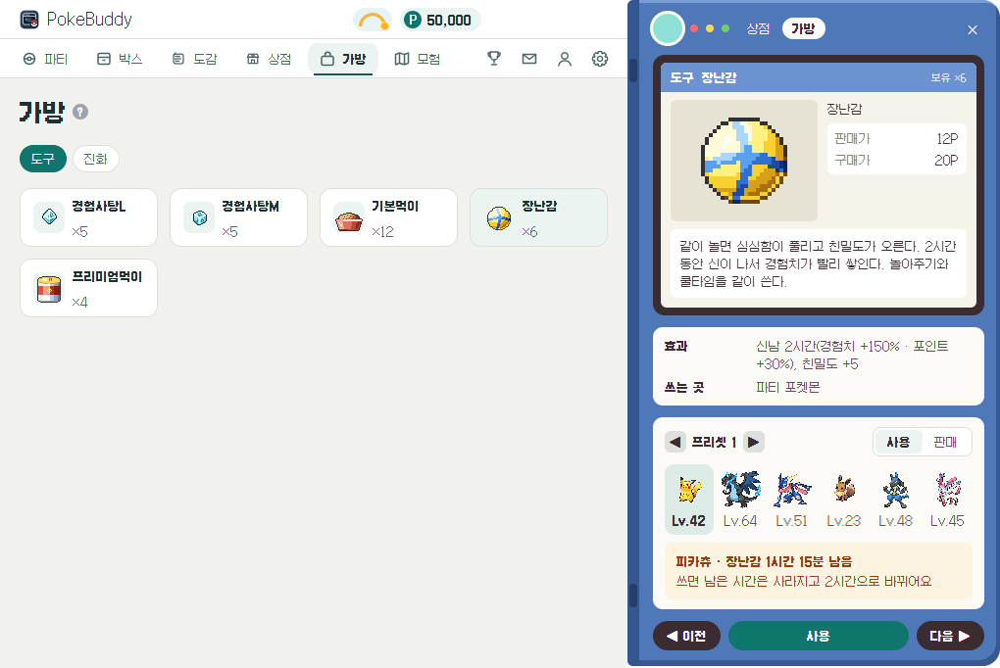

- 친밀도는 시간이 지나도 오르지 않고 줄지도 않아요. 밥 주기로도 오르지 않아요.
- 프리미엄먹이는 만복도가 100 이면 쓸 수 없어요. 쓴 뒤 2시간 동안 만복도가 줄지 않아서 다시 쓰기 어려워요.

### 진화시키는 법

조건을 채우면 알림이 뜨고, 파티 상세 기기 창의 진화 줄에서 직접 진화해요.

1. 파티나 박스의 포켓몬을 눌러 파티 상세 기기 창을 열어요.
2. `진화` 줄을 눌러요. 진화 트리와 필요한 조건이 보여요.
3. 갈래가 여럿이면 조건을 채운 갈래 가운데 하나를 골라요.
4. `진화` 를 눌러요. 진화의돌 같은 도구는 1개를 써요.

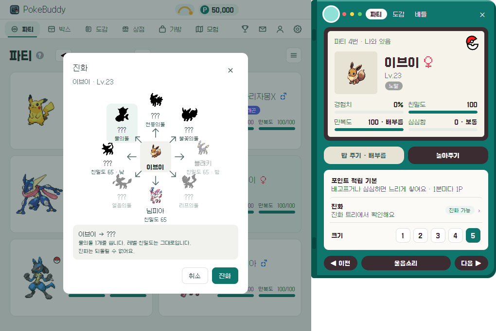

| 조건 | 내용 |
|---|---|
| 레벨 | 그 레벨이 되면 돼요 |
| 친밀도 | 65, 85, 100 가운데 하나예요. 예: 피츄는 85 |
| 진화 도구 | 진화의돌 등. 상점 `진화` 탭에서 150P(족자만 2,000P) |
| 낮·밤 | 10분마다 바뀌어요. 진화 줄에 남은 시간이 보여요 |
| 지도 | 알로라 라이츄 같은 다른 지방 모습. 돌 대신, 또는 레벨·친밀도에 더해 써요 |
| 연결의끈 | 원작에서 교환으로 진화하는 종. 교환해도 진화하지 않아요 |

- 자동으로 진화하지 않아요. 진화하지 않고 두어도 돼요.
- 진화 도구는 바탕화면 포켓몬이 줍기로 주워 오기도 해요(족자 제외).

자세한 규칙은 [성장과 진화](#성장과-진화)에 있어요.

### 메가진화 하는 법

메가스톤은 사지 않아요. 조건을 채운 포켓몬에게 저절로 생겨요.

1. 리자몽·팬텀처럼 메가진화하는 포켓몬을 파티에 넣어요. 메가진화 모습은 60개예요(메가 58, 원시회귀 2).
2. 아래 네 조건을 모두 채워요.

| 조건 | 기준 |
|---|---|
| 친밀도 | 100 |
| 레벨 | Lv.60 이상 |
| 파티에 있는 시간 | 친밀도 100 이 된 뒤 24시간 |
| 놀아주기 | 친밀도 100 이 된 뒤 30번. 장난감 한 번은 2번으로 세요 |

3. 메가스톤이 생기면 알림이 떠요. 메가스톤은 없어지지 않아요.
4. 파티 상세 기기 창 그림 오른쪽 아래의 메가스톤을 눌러 메가진화해요. 다시 누르면 돌아와요.
5. 배틀에서는 배틀 파티 상세 기기 창에서 켜요.

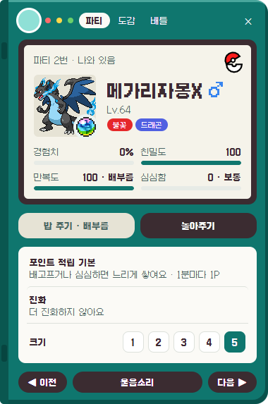

- 놀아주기 30번은 장난감 15개(300P, 약 2시간 30분)로 채울 수 있어요.
- 파티 프리셋에서는 여러 마리가 함께 메가진화할 수 있어요. 박스로 옮기면 풀려요.
- 배틀 파티에는 메가진화를 1마리만 내요. 원시회귀도 이 1마리에 들어가요.

### 알 고르기와 원하는 포켓몬 얻기

랜덤알로 종을 늘리고, 원하는 등급은 그 등급의 알을 사요.

| 알 | 가격 | 나오는 포켓몬 |
|---|---|---|
| 랜덤알 | 120P | 해금한 종 |
| 태고의돌 | 200P | 화석 포켓몬 15종 |
| 랜덤준전설알 | 2,000P | 아직 없는 준전설 43종 가운데 |
| 랜덤울트라비스트알 | 2,000P | 아직 없는 울트라비스트 10종 가운데 |
| 랜덤패러독스알 | 2,000P | 아직 없는 패러독스 20종 가운데 |
| 랜덤환상알 | 3,000P | 아직 없는 환상 20종 가운데 |
| 랜덤전설알 | 5,000P | 아직 없는 전설 24종 가운데 |

- 알은 5분이면 준비돼요. 돌보미집에는 6개까지 둬요.
- 랜덤알에서는 흔한 종이 잘 나오고 드문 종은 덜 나와요.
- 랜덤알을 열면 5.5% 확률로 다른 알이 나와요. 태고의돌 3%, 준전설알 1%, 울트라비스트알·패러독스알 각 0.5%, 환상알 0.3%, 전설알 0.2% 예요.
- 이로치는 1/1000 확률로 나와요.

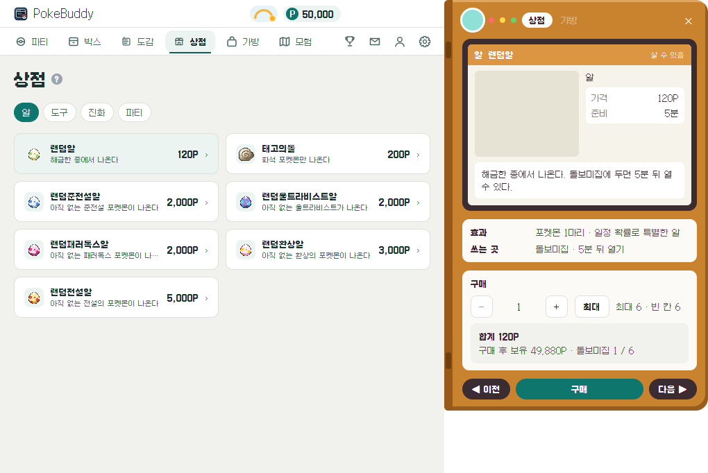

업적으로만 얻는 포켓몬이 8종 있어요.

| 포켓몬 | 업적 | 조건 |
|---|---|---|
| 뮤 | 관동 도감 완성 | 1~150번 모으기(뮤 제외) |
| 피츄(삐쭉귀) | 성도 도감 완성 | 152~251번 모으기 |
| 아르세우스 | 디아루가·펄기아·기라티나 모으기 | 세 종 모두 얻기 |
| 마기아나(500년 전의 색) | 볼케니온·마기아나 모으기 | 두 종 모두 얻기 |
| 토게피 | 알 50개 부화 | 알 50개 열기 |
| 메타몽 | 파티 세 마리 모으기 | 지금 파티에 3마리 |
| 로토무 | 처음 함께 일하기 | 연결한 AI 코딩 도구가 처음 일하기 |
| 라프라스 | 함께 100시간 일하기 | AI 코딩 도구 작업 100시간 |

- 친구 교환으로도 얻어요. 다만 준전설·전설 같은 단일 포켓몬 알의 종과 업적 보상 종은 교환할 수 없어요.

### 배틀 이기는 법

단단한 포켓몬을 앞 열에 두고, 기술 타입을 고루 고르는 것이 기본이에요.

1. 배틀 파티 6칸을 모두 채워요. 한 마리만 비어도 크게 불리해요.
2. HP·방어·특방이 높은 포켓몬을 앞 열(2·4·6번 칸)에 둬요. 앞 열은 사거리 1 이라 붙어서 싸워요. 모험 탭에서는 오른쪽 열이에요.
3. 뒤 열(1·3·5번 칸)에는 사거리 3 으로 멀리서 칠 포켓몬을 둬요.
4. 기술을 직접 골라요. 기술 타입을 여러 가지로 고르면 약점이 겹치지 않아요.
5. 메가스톤이 있으면 메가진화를 켜요.

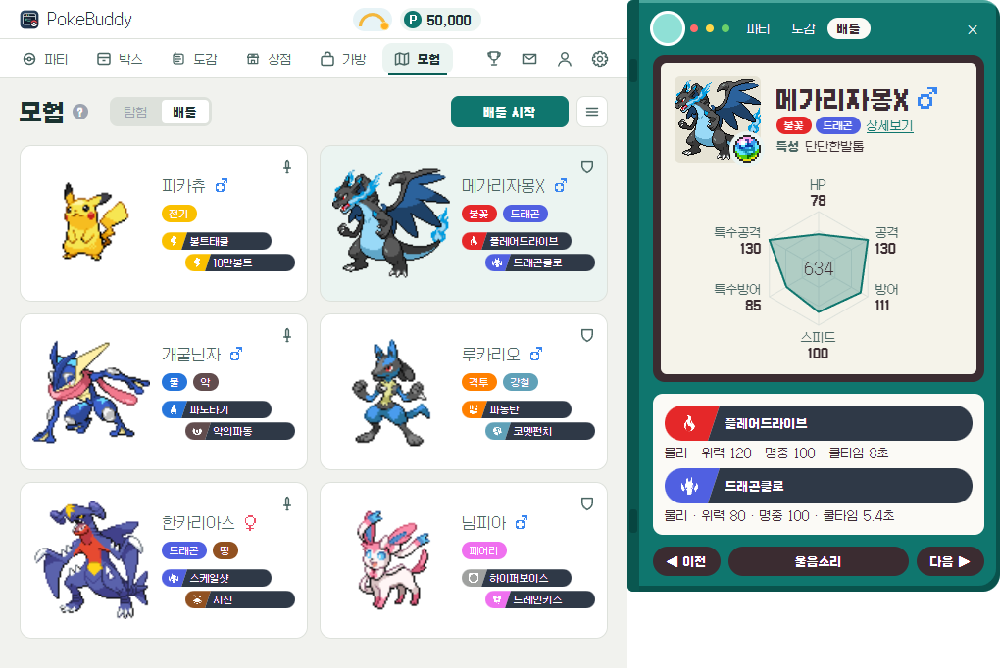

| 알아 둘 규칙 | 내용 |
|---|---|
| 레벨 | 모두 Lv.50, 개체값 최대, 노력치 0 으로 계산해요. 레벨을 올리지 않아도 돼요 |
| 타입 상성 | 원작 18타입 표 그대로예요. 효과가 굉장하면 2배, 별로면 0.5배, 없으면 0 이에요. 두 타입이면 곱해요 |
| 자속 | 자기 타입 기술은 1.5배예요 |
| 기술 순서 | 1번 → 2번 → 1번 순서로 번갈아 써요. 차례가 온 기술이 준비 중이면 기다려요 |
| 대기 시간 | 기술마다 2~16초예요. 위력이 셀수록 길고, 빠른 포켓몬일수록 조금 짧아요 |
| 판 길이 | 90초가 지나면 남은 HP 비율로 승부를 정해요 |
| 날씨·필드 | 그 특성을 가진 포켓몬이 있으면 판 시작에 하나가 뽑혀요. 맞는 타입 기술이 1.3배 세져요 |

- 출전 제한은 초전설 1마리, 초전설과 준전설 합 3마리, 메가진화 1마리예요. 자세한 규칙은 [출전 제한](#출전-제한)에 있어요.

### 업적 빨리 깨기

업적은 44개예요. 쉬운 업적부터 깨고, 오래 걸리는 업적은 켜 두는 동안 저절로 쌓이게 둬요.

먼저 깨기 쉬운 업적이에요.

| 업적 | 조건 | 보상 |
|---|---|---|
| 두 마리 함께 꺼내기 | 파티 2마리를 바탕화면에 꺼내기 | 파티 칸 |
| 파티 세 마리 모으기 | 지금 파티에 3마리 | 메타몽 |
| 처음 함께 일하기 | AI 코딩 도구 연결 뒤 첫 작업 | 로토무 |
| 첫 진화 | 진화 1번 | 100P |
| 첫 친밀도 100 | 친밀도 100 한 마리(장난감으로 약 3시간) | 200P |
| 알 10개 부화 | 알 10개 열기(랜덤알 1,200P) | 200P |
| 50번 줍기 | 무엇이든 50번 줍기 | 100P |
| 7일 연속 함께하기 | 7일 연속 켜기. 하루를 거르면 처음부터예요 | 200P |

보상이 큰 업적이에요.

| 업적 | 보상 |
|---|---|
| 포켓몬 1000종 모으기, 함께 1000시간 일하기 | 랜덤전설알 |
| 포켓몬 600종 모으기, 함께 300시간 일하기 | 랜덤환상알 |
| 포켓몬 300종 모으기, 알 200개 부화, 함께 50시간 일하기 | 랜덤준전설알 |
| 지방 도감 완성(호연~팔데아 8개) | 각 1,000P |
| 3000번 줍기 | 1,500P |
| 이로치 10종 모으기 | 모습이 바뀌는 약 |
| 최초로 50레벨 포켓몬 달성 | 파티 칸 |

### 경험치·레벨 빨리 올리는 법

장난감의 신남 버프가 경험치를 2.5배로 올려요. 레벨을 올릴 때는 장난감이 가장 싸요.

| 상태 | 시간당 경험치 |
|---|---|
| 기본 | 6,000 |
| 프리미엄먹이 | 7,200 |
| 장난감 | 15,000 |
| 둘 다 | 16,200 |

1. 레벨을 올릴 포켓몬을 파티에 넣어요. 박스의 포켓몬은 경험치를 받지 않아요.
2. 장난감을 써요. 장난감 1개(20P)로 2시간 동안 경험치가 18,000 더 쌓여요.
3. 배가 고프지 않게 해요. 배고프면 70%, 매우 배고프면 40% 로 줄어요. 심심함은 경험치에 영향이 없어요.
4. 급하면 사탕을 써요.

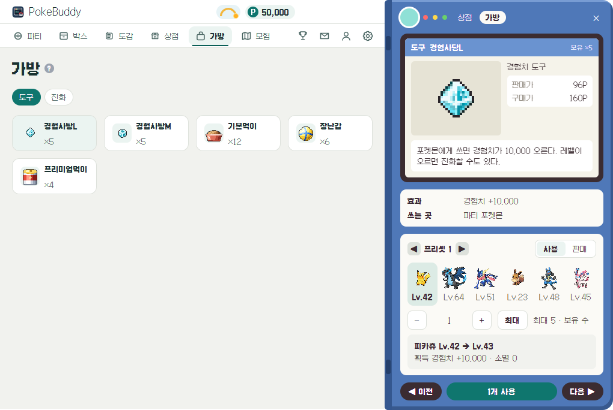

| 사탕 | 효과 | 가격 |
|---|---|---|
| 경험사탕L | 경험치 +10,000 | 160P |
| 경험사탕XL | 경험치 +30,000 | 320P |
| 이상한사탕 | 레벨 +1 | 200P |

- 이상한사탕은 지금 레벨에서 쌓은 경험치를 버리고 다음 레벨 시작으로 맞춰요. 레벨이 막 오른 직후에 쓰면 손해가 없어요.
- 최대 레벨은 100 이에요.
- 보통 빠르기로 크는 종은 Lv.60(메가스톤 조건)까지 기본 36시간, 장난감과 프리미엄먹이를 함께 쓰면 약 13시간 걸려요.

## 계정과 우편함

- 로그인은 선택이에요. 헤더의 유저 아이콘 → `계정` 탭에서 아이디+비밀번호 또는 GitHub 으로 로그인해요.
- 앱은 진행의 저장 사본을 서버에 둬요(클라우드 저장). 게임은 계속 내 컴퓨터에서 돌아요.
- 로그인하지 않으면 앱이 익명 계정을 만들어 저장해요. `계정` 탭에 `익명으로 저장 중` 이 보여요.
- 익명 계정으로는 교환하지 못해요. 우편함 선물도 받지 못해요.
- 헤더의 봉투 아이콘은 우편함이에요. 운영자가 보낸 편지를 읽어요. 선물이 든 편지는 열어서 `받기` 를 눌러요. 선물은 로그인한 계정만 받아요.

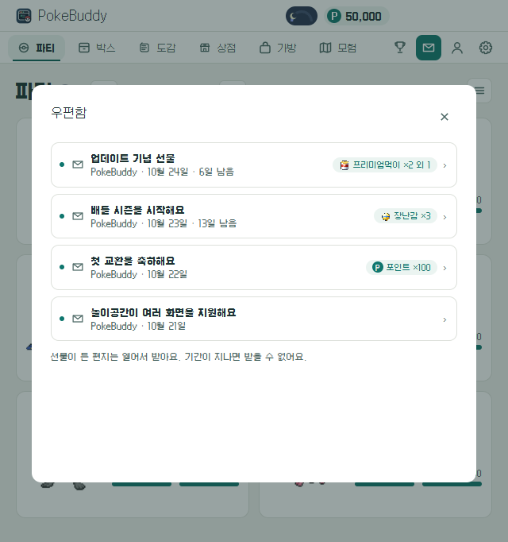

### 클라우드 저장

- 앱이 자동으로 올려요. 바로 올리고 싶으면 `계정` 탭 `저장` 줄의 `저장하기` 를 눌러요.
- 사거나 쓰는 것처럼 조작으로 바뀐 진행은 2분에 한 번 올려요.
- 시간만 흘러 바뀐 진행(포인트·경험치 적립 등)은 10분에 한 번 올려요. 앱을 끄거나 PC 가 잠들 때도 올려요.
- 교환, 부화, 진화, 첫 포켓몬 고르기, 우편함 선물 받기, 줍기로 얻은 포켓몬은 바로 올려요.
- 오프라인에서 한 진행은 다시 연결되면 자동으로 올려요.
- 헤더의 저장 표시가 상태를 보여 줘요. 누르면 `계정` 탭이 열려요. `업데이트 필요` 일 때 누르면 설정 모달이 열려요.
- 로그인한 계정은 클라우드 저장이 서버에 연결되어 올릴 수 있을 때만 교환을 시작하거나 참가해요. 우편함 선물 받기도 같아요.
- `연결 중`·`오프라인`·`업데이트 필요` 상태이거나 올리기가 막혀 있으면 교환과 선물 받기를 거절하고 안내를 띄워요.

| 저장 표시 | 뜻 |
|---|---|
| `저장됨 · 3분 전` | 계정에 올렸어요. 익명 계정도 같아요. 마지막으로 올린 시각이에요 |
| `연결 중` | 서버에 연결하고 있어요 |
| `오프라인` | 서버에 닿지 않아요. 게임은 그대로 해요 |
| `업데이트 필요` | 서버가 이 버전을 받지 않아요. 게임은 그대로 해요. 앱을 업데이트할 때까지 올리지 않아요 |
| `확인 대기` | 연결 끊긴 PC 확인 창이 떠 있어요. 게임이 멈춰요 |
| `넘겨받지 못함` | 교환 때문에 계정을 넘겨받지 못했어요. 게임이 멈춰요 |
| `다른 PC 에서 시작` | 다른 PC 가 이 계정을 이어받았어요. 이 PC 는 곧 꺼져요 |
| `저장 꺼짐` | 이 PC 의 저장 계정 정보를 찾지 못했어요. 게임은 그대로 해요. 올리지 않아요 |
| `이용 정지` | 계정이 이용 정지됐어요. 앱은 정지 안내를 띄운 뒤 꺼져요 |

### 저장 파일

- 이 PC 의 저장 파일([저장 폴더](#저장-폴더)의 `save.json`)은 암호화되어 있어요. 메모장으로 열어도 읽을 수 없어요.
- 앱이 저장 파일을 읽지 못하면 그 파일을 `save.json.broken-<시각>.bak` 으로 옮겨요. 저장 파일을 고쳤을 때가 그래요.
- 그다음 첫 포켓몬 선택 창이 떠요. 계정에 저장이 있으면 포켓몬을 고른 뒤 계정 저장으로 돌아와요. 계정 저장이 없으면 처음부터 시작해요.
- 업데이트 뒤 처음 켤 때 기존 저장을 암호화해요. 암호화 전 저장은 `save.json.plain-<시각>.bak` 으로 남아요.
- 켤 때 `저장을 열지 못했어요` 창이 뜨면 앱이 저장을 풀 키를 쓰지 못한 거예요. Mac 에서 키체인 허용 창의 `거부` 를 눌렀을 때가 그래요.
  - `종료` 를 누르면 저장을 그대로 두고 끝나요. 키체인 접근을 허용한 뒤 다시 켜요.
  - `새로 시작` 을 누르면 지금 저장을 `save.json.unreadable-<시각>.bak` 으로 백업하고 처음부터 시작해요. 계정에 저장이 있으면 포켓몬을 고른 뒤 계정 저장으로 돌아와요.

### 두 PC 에서 쓰기

같은 계정은 한 번에 PC 하나(활성 PC)만 써요.

- 다른 PC 에서 앱을 켜면 그 PC 가 계정 저장을 받아 이어서 해요. 고르는 창은 없어요.
- 먼저 켜져 있던 PC 는 "다른 PC 에서 시작" 안내를 띄운 뒤 꺼져요. 안내는 30초 뒤 저절로 닫혀요.
- 꺼진 PC 는 로그인을 유지해요. 그 PC 를 다시 켜면 계정 저장을 받아 이어서 해요.
- 먼저 켜진 PC 의 마지막 진행(조작은 2분, 시간만 흐른 진행은 10분)은 다른 PC 로 넘어가지 않을 수 있어요. 앞 PC 를 끄고 다른 PC 를 켜면 잃지 않아요.
- 오프라인으로 켠 PC 가 나중에 연결되면 다음처럼 돼요. 활성 PC 가 온라인이면 나중에 연결된 PC 가 "다른 PC 에서 시작" 안내 뒤 꺼져요.

활성 PC 가 연결 끊김 상태면 다른 PC 가 시작할 때 확인 창이 떠요. 연결 끊김은 활성 PC 가 2분 30초 넘게 서버에 닿지 않은 상태예요. 확인 창이 떠 있는 동안 게임이 멈춰요.

- `여기서 시작` 을 누르면 이 PC 가 이어서 해요. 연결 끊긴 PC 가 서버에 올리지 못한 진행은 사라져요.
- `취소` 를 누르면 이 PC 의 앱이 꺼져요. 연결 끊긴 PC 에서 이어서 하려면 그 PC 를 다시 연결해요.

다른 PC 에서 교환이 진행 중이면 넘겨받지 못해요. 다른 PC 에서 끝낸 교환이 아직 계정 저장에 들어가지 않았을 때도 넘겨받지 못해요(끝낸 지 7일 이내). 이때 뜨는 창에서 `다시 시도` 나 `종료` 를 눌러요.

### 잠금과 절전

- 화면을 잠그거나 절전에 들어가면 PC 는 잠듦 상태를 서버에 알려요.
- 잠듦 상태 PC 는 연결 끊김으로 보지 않아요. 다른 PC 를 켜면 확인 창 없이 이어서 해요.
- 앱을 끄거나 업데이트로 다시 켤 때도 마지막 진행을 올린 뒤 꺼요.
- Windows 를 끄거나 로그오프하면 올리기를 마치지 못할 수 있어요. 이때 다른 PC 에서 확인 창이 한 번 뜰 수 있어요.

### 로그인·로그아웃·계정 삭제

- 익명 계정으로 저장하다가 로그인하면 이 PC 진행을 로그인한 계정으로 옮겨요. 로그인한 계정에 저장이 없을 때만 옮겨요.
- 로그인한 계정에 저장이 이미 있으면 그 계정 저장을 받아 이어서 해요. 이 PC 진행은 백업 파일로 남겨요.
- 익명 저장에 교환으로 보낸 포켓몬이 남아 있으면 그 저장은 옮기지 않아요. 로그인한 계정에 저장이 있으면 그 계정 저장을 받아요.
- 로그인하면 익명 계정은 서버에서 지워요. 진행을 옮기지 않았을 때도 지워요.
- 로그아웃하면 확인 창이 떠요. `로그아웃하고 새로 시작` 을 누르면 이 PC 는 처음부터 새로 시작해요.
- 로그아웃해도 계정 저장은 서버에 그대로 있어요. 다시 로그인하면 이어서 해요.
- 올리지 못한 진행이 있을 수 있으면 로그아웃·계정 삭제 확인 창에 경고 줄이 보여요. 오프라인일 때가 그래요. 그 진행은 이 PC 백업 파일에만 남아요.
- 계정을 삭제하면 계정과 계정 저장을 지워요. 이 PC 도 처음부터 새로 시작해요. 되돌릴 수 없어요.
- 새로 시작하면 앱이 다시 켜지고 첫 포켓몬 선택 창이 떠요. 이 PC 의 진행은 `save.json.signout-<시각>.bak` 또는 `save.json.delete-<시각>.bak` 로 남아요.
- 교환 중에는 로그인·로그아웃·계정 삭제를 할 수 없어요.

### 이용 정지

- 계정 저장에서 정상 플레이로 만들 수 없는 변화가 발견되면 운영자가 계정을 이용 정지할 수 있어요.
- 정지된 계정으로 켜면 `이용이 정지됐어요` 안내가 떠요. `종료` 를 누르면 앱이 꺼져요. 오프라인으로 켜도 같아요.
- 운영자가 확인한 뒤 정지를 풀면, 다음에 켤 때 마지막으로 계정에 저장된 진행으로 이어서 해요.

### 저장 정보를 찾지 못했을 때

이 PC 의 로그인 정보가 지워졌거나 서버에서 계정이 사라지면 `저장 정보를 찾지 못했어요` 창이 떠요. 게임은 멈추지 않아요. 클라우드 저장만 꺼져요.

- 로그인한 계정이었으면 `로그인` 을 눌러요. `계정` 탭에서 다시 로그인하면 계정 저장으로 이어서 해요.
- 로그인한 계정이었고 `이 PC 저장으로 계속` 을 누르면 새 익명 계정을 만들어 이 PC 진행을 저장해요.
- 익명 계정이었으면 서버에 둔 익명 저장은 되찾지 못해요. `이 PC 저장으로 계속` 을 누르면 새 익명 계정으로 이 PC 진행을 이어서 저장해요.
- 익명 계정이었고 `처음부터` 를 누르면 이 PC 진행을 `save.json.fresh-<시각>.bak` 로 백업하고 앱을 다시 켜요.
- GitHub 이나 아이디로 로그인해 두면 이 PC 의 로그인 정보를 잃어도 다시 로그인해 이어서 해요.

## 설정

설정은 헤더의 톱니바퀴로 열어요.

| 탭 | 항목 |
|---|---|
| `일반` | 잠들기 기준, 언어(한국어·영어), 로그인 시 시작, 소리, 알림, 가이드북 |
| `화면` | 포켓몬 표시, 고스트 모드, 놀이공간 |

모달 아래 왼쪽에 지금 버전, 업데이트 상태, `패치노트` 가 있어요.
모달 아래 오른쪽 끝에 `저작권 안내` 가 있어요. 누르면 브라우저에서 [README 의 라이선스 절](../README.md#라이선스)이 열려요.

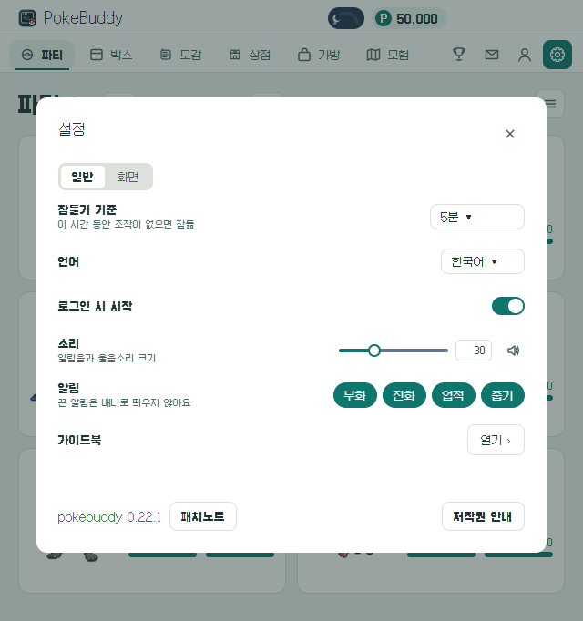

## AI 코딩 도구 연결

Claude Code, Codex CLI, Gemini CLI 를 쓰면 포켓몬이 AI 의 작업 상태에 따라 움직여요. 쓰지 않아도 게임은 전부 돼요.

- 헤더의 유저 아이콘 → `연결` 탭에서 CLI 마다 `연결` 을 눌러요. `해제` 를 누르면 그 CLI 에서 우리 등록만 지워요.
- 연결하려면 Node.js 가 있어야 해요. 훅을 `node` 로 실행하기 때문이에요. 없으면 `연결` 탭 위에 경고가 뜨고 `연결` 이 막혀요. Node.js 를 설치한 뒤 `다시 확인` 을 눌러요.
- 연결된 CLI 줄에는 마지막 신호 시각이 보여요. `점검` 을 누르면 훅을 한 번 실제로 돌려 보고 결과를 그 줄에 보여요.
- Codex CLI 는 0.124 이상, Gemini CLI 는 0.26 이상이 필요해요. Codex CLI 0.129 이상은 새 훅을 codex 의 `/hooks` 에서 한 번 승인해야 돌아요.
- 맨 앞 창이 터미널이면 그 터미널 앱에서 띄운 CLI 의 상태를 따라요. 브라우저 같은 다른 창을 보면 마지막 상태를 유지해요.
- 연결한 CLI 가 일하는 동안에는 심심함이 더 빨리 쌓여요. 친밀도와 포인트는 더 쌓이지 않아요. 수치는 [밸런스 수치](specs/balance.md)에 있어요.

| 상태 | 언제 | 포켓몬 |
|---|---|---|
| 작업 중 | 프롬프트를 보냄 · 도구를 실행함 | 빠르게 걷고 공격 · 기 모으기 같은 작업 동작을 해요 |
| 승인 대기 | 도구 승인 · 질문에 답하기를 기다림 | 두리번거려요 |
| 인사 | 세션 시작 · 턴 끝 | 잠깐 인사해요 |
| 실패 | 도구나 턴이 실패함 | 쓰러져요 |
| 한가 | 그 밖 | 느리게 산책하고 졸아요 |

CLI 별 이벤트와 판정 방법은 [동반자 동작](specs/companion.md#cli-llm-상태-연동)에 있어요.

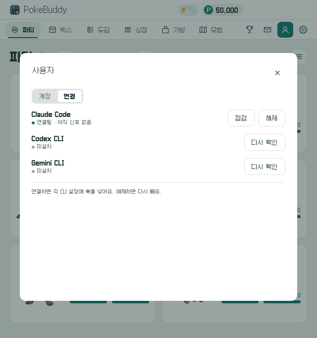

## 문제 해결

| 증상 | 확인할 것 |
|---|---|
| Windows 에서 "Windows의 PC 보호" 창이 떠요 | `추가 정보` → `실행` 을 눌러요. 코드 서명이 없어서 떠요 |
| Mac 에서 "Apple 이 확인할 수 없음"이 떠요 | 시스템 설정 → 개인정보 보호 및 보안 → `그래도 열기` 를 눌러요 |
| Mac 에서 "손상되었기 때문에 열 수 없습니다"가 떠요 | 터미널에서 `xattr -dr com.apple.quarantine /Applications/PokeBuddy.app` 을 실행해요 |
| 포켓몬이 바탕화면에 나오지 않아요 | 처음 나오는 포켓몬은 그림을 받느라 몇 초 걸려요. 인터넷 연결을 확인해요. 그림을 못 받은 포켓몬은 나오지 않아요. 이유는 [저장 폴더](#저장-폴더)의 `last-error.json` 에 남아요 |
| 포켓몬을 옮기거나 누를 수 없어요 | 고스트 모드가 켜져 있는지 트레이 메뉴에서 확인해요 |
| AI 작업 중인데 포켓몬이 반응하지 않아요 | 사용자 → `연결` 탭에서 그 CLI 가 `연결됨` 인지, 마지막 신호가 최근인지 확인해요. `점검` 이 실패하면 이유를 따라요. 그 CLI 를 띄운 터미널 창이 맨 앞에 있어야 해요 |
| Windows 에서 Codex 를 쓰면 콘솔 창이 깜빡여요 | `codex --no-daemon` 으로 실행하거나 Codex 연결을 `해제` 해요 |

저장소에서 실행했다면 `pokebuddy status` 가 판정 상태를 한 번에 보여 줘요. 방법은 [개발과 배포](contributing/development.md#문제-확인)에 있어요.

## 그림과 라이선스

코드는 MIT 라이선스예요. 자세한 내용은 [LICENSE](../LICENSE) 를 참고해요.

pokebuddy 는 팬이 만든 비공식 앱이에요. Nintendo · Creatures Inc. · GAME FREAK inc. · The Pokémon Company 와 제휴하지 않았어요. 승인이나 후원도 받지 않았어요.
포켓몬과 포켓몬 캐릭터의 권리는 Nintendo · Creatures Inc. · GAME FREAK inc. 에 있어요.

- 이 앱은 무료예요. 개인 용도와 비상업 팬 용도로만 써요. 후원을 받지 않고 유료 기능도 없어요.
- 이 앱을 돈을 받고 파는 곳은 이 프로젝트와 관계가 없어요.
- 권리자가 요청하면 그림 받기와 배포를 멈춰요. 요청은 [이슈](https://github.com/MilkLotion/pokebuddy/issues)로 받아요.
- 포켓몬 그림 파일은 이 저장소와 설치 파일에 들어 있지 않아요. 처음 실행할 때 받아서 [저장 폴더](#저장-폴더)에 캐시해요.

그림을 받는 곳은 다음과 같아요. 출처와 제작자의 전체 목록은 [README 의 라이선스 절](../README.md#라이선스)에 있어요.

- 바탕화면의 움직이는 그림은 [PMDCollab/SpriteCollab](https://github.com/PMDCollab/SpriteCollab) 기여자들의 작품이에요. 라이선스는 CC BY-NC 4.0(저작자 표시·비상업)이에요. 이 앱으로 만든 화면을 공유할 때는 저작자와 출처를 함께 밝혀요.
- PMDCollab 에 그림이 없는 종은 [rh-hideout/pokeemerald-expansion](https://github.com/rh-hideout/pokeemerald-expansion) 의 따라다니기 그림으로 걸어요.
- 설정창의 초상·도구·알 그림, 도감 설명, 울음소리는 [PokeAPI](https://github.com/PokeAPI) 에서 받아요. 받는 곳의 상세는 [동반자 동작](specs/companion.md#그림에-대한-메모)에 있어요.
